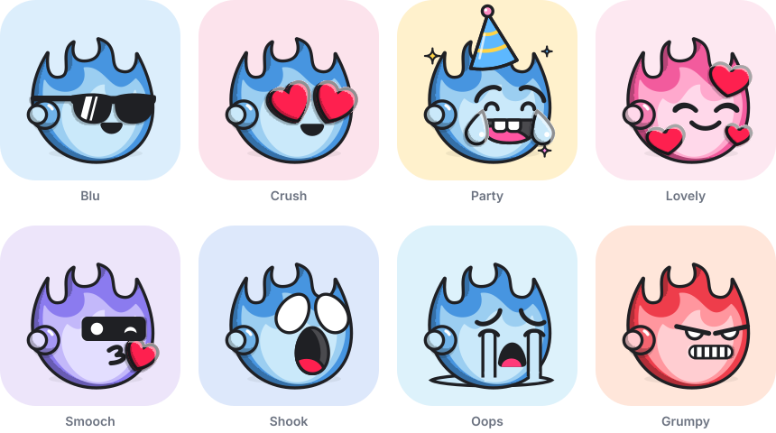

<p align="center">
  
</p>

<h1 align="center">Blu Studio</h1>

<p align="center">
  A tiny editor for making new versions of Blu, our brand mascot,<br>
  without redrawing him every time.
</p>

<p align="center">
  <a href="https://designerjuliamartins.github.io/blu-studio/"><b>Open Blu Studio</b></a>
</p>

---

## Meet Blu

Blu is a small blue flame who never gets too hot about anything. He wears his sunglasses indoors, smiles with half his mouth, and keeps a little knob on the side of his head that nobody has ever explained.

He started as one illustration. Then we needed him happy for a "you passed!" screen, crying for an empty state, wearing a party hat for a launch post, and in red for a "wrong answer" moment. Every new mood meant opening Figma, duplicating him, and nudging eyes around by hand.

Blu Studio is the shortcut. You pick the mood, and he's ready.

<p align="center">
  
</p>

## What you can change

| | |
|---|---|
| **Colour** | Brand blue plus seven more. Each recolours his three flame tones and his ear together, so he always looks like himself. |
| **Eyes** | His original shades, or visor, big eyes, hearts, happy, wink, crying, angry, glasses, dizzy and star eyes. |
| **Mouth** | His original smirk, or smile, grin, wow, tongue, flat, or none. |
| **On top** | Party hat, crown, halo, bow or cap. |
| **Extras** | Ear knob, inner shadow, blush, floating hearts, sweat drop, sparkles, bandage. |
| **Background** | A coloured tile, or transparent. |

There are six starting points (Blu, In love, Party, Champion, Oops, Angry red), a "Surprise me" button for when you need ideas, and a little shelf to save the versions you like. Saved versions stay in your browser.

## Getting him into your work

- **Copy SVG.** Paste into Figma with <kbd>Cmd</kbd> + <kbd>V</kbd>. Every shape arrives as an editable vector layer, so you can still tweak him by hand.
- **Copy PNG.** A 3× image for slides, docs and chats.
- **Place in Figma.** Paste a Figma file or frame link and Blu lands right there, named after the choices you made (for example `Blu / Brand blue / Hearts / Crown`). This one uses your own Figma connection, so it only works when the page is opened inside Claude with the Figma connector on. Everywhere else, Copy SVG does the same job in one extra step.

## How Blu is drawn

Blu is built from the original vector paths of his Figma component, not traced or redrawn, so the default version matches the brand file exactly. Every new expression is drawn on top of that body, following his rules:

| Part | Value |
|---|---|
| Outline | `#1F2024`, 8 px, round joins |
| Flame, outer | `#4795E0` with a soft inner shadow on the right |
| Flame, middle | `#9BCEF1` |
| Flame, inner | `#CAE9FA` |
| Ear knob | `#6FB2E8`, with the inner tone as its centre |
| Shine | White strokes only, never gradients |

If you add something new to him, keep to flat colours, the same outline weight, and a white shine. That's what makes him look like Blu and not a sticker someone else drew.

## Running it locally

It's a single HTML file with no build step and no dependencies.

```bash
git clone https://github.com/designerjuliamartins/blu-studio.git
cd blu-studio
open index.html
```

To teach Blu a new expression, look for the `eyes()` and `mouth()` functions in `index.html`. Both draw in the same 347 × 340 space as the original component, with his eyes centred around `EYE_L` and `EYE_R` and his mouth around `MOUTH`. Add a case, give it a name in `EYES` or `MOUTHS`, and it shows up in the panel.

## Credits

Blu's body, sunglasses and smirk come from the **cold-flame** character in the [Emojibotos](https://www.figma.com/community/search?resource_type=mixed&sort_by=relevancy&query=emojibotos) file on the Figma Community. All credit for the original character goes to its creator. The editor, the extra expressions and accessories, and the colour variations were made for this project.

The code is MIT licensed. The character artwork follows the licence of the original Community file.

---

<p align="center">
  Made by <a href="https://github.com/designerjuliamartins">Julia Martins</a>, product designer,<br>
  for the days when the mascot needs a new mood by this afternoon.
</p>
